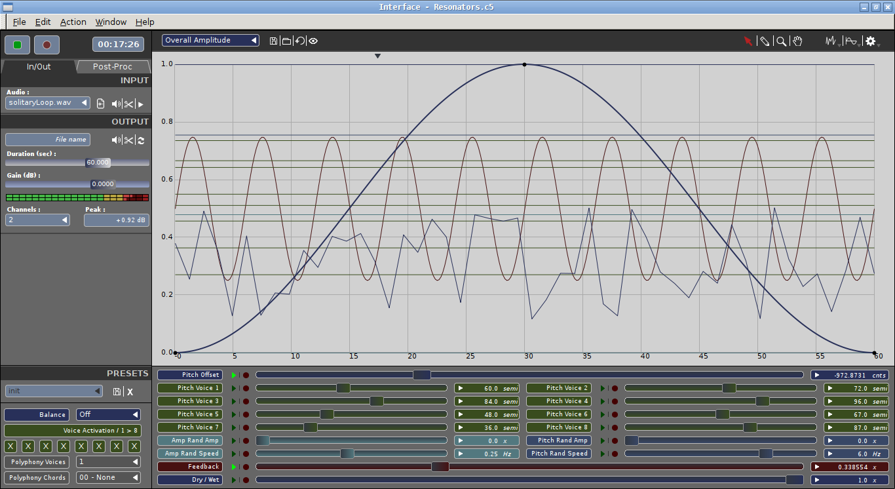

=======================================
Cecilia5 - the audio processing toolbox
=======================================

Cecilia is an audio signal processing environment. Cecilia lets you create 
your own GUI (grapher, sliders, toggles, popup menus) using a simple syntax. 
Cecilia comes with many original builtin modules for sound effects and synthesis.

Previously written in tcl/tk, Cecilia (version 4, named Cecilia4) was entirely 
rewritten in Python/wxPython and uses the Csound API for communicating between 
the interface and the audio engine. At this time, version 4.2 is the last 
release of this branch.

Cecilia5 now uses the pyo audio engine created for the Python programming 
language. pyo allows a much more powerfull integration of the audio engine to 
the graphical interface. Since it's a standard python module, there is no need 
to use an API to communicate with the interface.

User documentation
------------------

To consult the user online documentation, go to
`documentation <https://belangeo.github.io/cecilia5/>`_.

Requirements
------------

* Install `Python <https://www.python.org/downloads/>`_ (3.11 or higher)

The programming language used to code the application.

Install with pip
----------------

Install Cecilia from PyPI using the command for your operating system.
Replace ``3.14`` with the Python version installed on your system.

Windows::

    py -3.14 -m pip install -U cecilia

Linux/macOS::

    python3.14 -m pip install -U cecilia

Then run it::

    cecilia

On Linux, Windows or macOS, register Cecilia in your application menu by running once
after installation::

    cecilia-register-desktop

On Linux, this creates ``~/.local/share/applications/cecilia.desktop`` for your
user. On Windows, it creates a ``Cecilia5`` shortcut in your Start menu using
Windows PowerShell. The shortcut launches Cecilia without a console window.
On macOS, this creates a lightweight ``~/Applications/Cecilia5.app`` launcher
with the Cecilia icon, which you can open in Finder or drag to the Dock. It uses
the current Python installation without opening Terminal. Registration refreshes
an existing launcher but refuses to overwrite a standalone application.

If you installed Cecilia in a virtual environment, run the command from that
environment and keep it installed for the menu entry to work. Run the command
again if you move or reinstall Cecilia in a different environment.

The macOS launcher uses the built-in ``osacompile`` and ``codesign`` tools to
create a locally ad hoc signed applet; it is not Developer ID signed or notarized.
It includes a microphone usage description, but audio input still requires your
permission in System Settings > Privacy & Security > Microphone. Permission
attribution and persistence depend on your Python installation; this launcher
does not provide the signing or entitlement guarantees of a standalone app.

Run from source
---------------

Install dependencies
++++++++++++++++++++

* Install `Git <https://git-scm.com/downloads>`_

The tool needed to clone Cecilia5 source code (or you can just download a zip of the sources).

* Install dependencies (pyo, wxPython and numpy)

Windows::

    py -3 -m pip install -U --user pyo wxPython numpy

Linux/macOS::

    python3 -m pip install -U --user pyo wxPython numpy

Launch the application
++++++++++++++++++++++

Open a terminal (a Command Prompt on Windows), go to the `cecilia5` folder, and launch the application.

Windows::

    cd path\to\cecilia5
    py -3 Cecilia5.py

Linux/macOS::

    cd path/to/cecilia5
    python3 Cecilia5.py

Screenshot
----------

