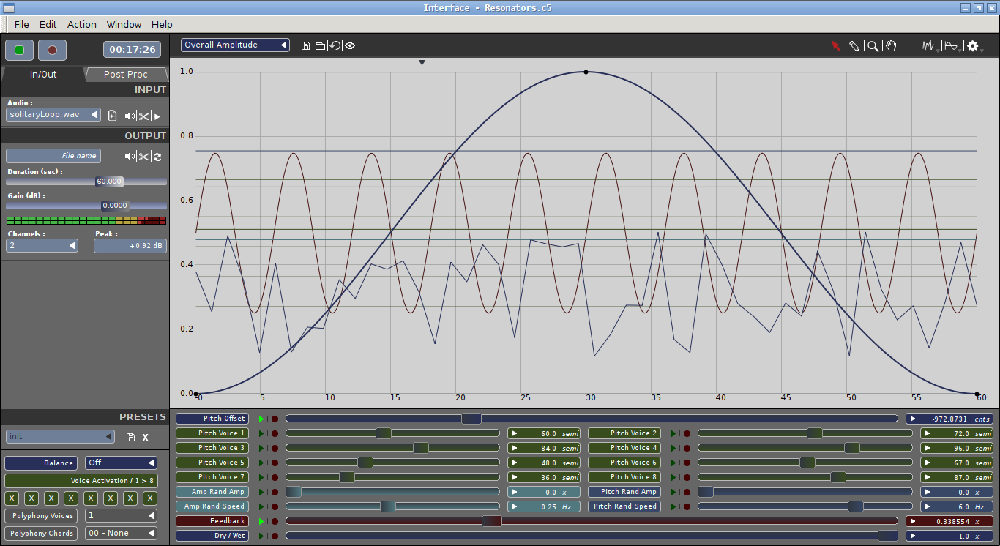

=======================================
Cecilia5 - the audio processing toolbox
=======================================

Cecilia is an audio signal processing environment. Cecilia lets you create 
your own GUI (grapher, sliders, toggles, popup menus) using a simple syntax. 
Cecilia comes with many original builtin modules for sound effects and synthesis.

Previously written in tcl/tk, Cecilia (version 4, named Cecilia4) was entirely 
rewritten in Python/wxPython and uses the Csound API for communicating between 
the interface and the audio engine. At this time, version 4.2 is the last 
release of this branch.

Cecilia5 now uses the pyo audio engine created for the Python programming 
language. pyo allows a much more powerfull integration of the audio engine to 
the graphical interface. Since it's a standard python module, there is no need 
to use an API to communicate with the interface.

User documentation
------------------

To consult the user online documentation, go to
`documentation <https://belangeo.github.io/cecilia5/>`_.

Undo and redo
-------------

Ctrl+Z and Ctrl+Shift+Z follow one session-wide history across routing,
module controls, curves, soundfiles, effects, presets, and output settings.
Undo and redo reveal and focus the affected module, view, and control.
Each drag or completed automation recording take is one action.

Changes that require rebuilding audio stop playback automatically; live-safe
control changes keep playing. Incoming MIDI/OSC values and automation playback
do not add history entries. Text fields retain their own editing undo.
History holds 100 actions in memory and is cleared when opening a new session.

Requirements
------------

* Install `Python <https://www.python.org/downloads/>`_ (3.11 or higher)

The programming language used to code the application.

Install with pip
----------------

Install Cecilia from PyPI::

    pip install cecilia

Build packages
--------------

From the repository root, using Python 3.11 or newer::

    python3 -m pip install build
    python3 -m build

This creates a source archive and a platform-independent wheel in ``dist/``.
Building the wheel does not require GUI or audio dependencies.

The separate macOS application build requires py2app and the runtime
dependencies. Install them into the build environment, then use
``scripts/builder_OSX.sh`` or ``python3 setup_py2app.py py2app``.

Run from source
---------------

* Install `Git <https://git-scm.com/downloads>`_

The tool needed to clone Cecilia5 source code (or you can just download a zip of the sources).

* Install dependencies (pyo, wxPython and numpy)

Windows::

    py -3 -m pip install --user pyo wxPython numpy

MacOS::

    python3 -m pip install --user pyo wxPython numpy

Launch the application
----------------------

Open a terminal (a Command Prompt on Windows), go to the `cecilia5` folder, and launch the application.

Windows::

    cd path\to\cecilia5
    py -3 Cecilia5.py

MacOS::

    cd path/to/cecilia5
    python3 Cecilia5.py

Screenshot
----------

